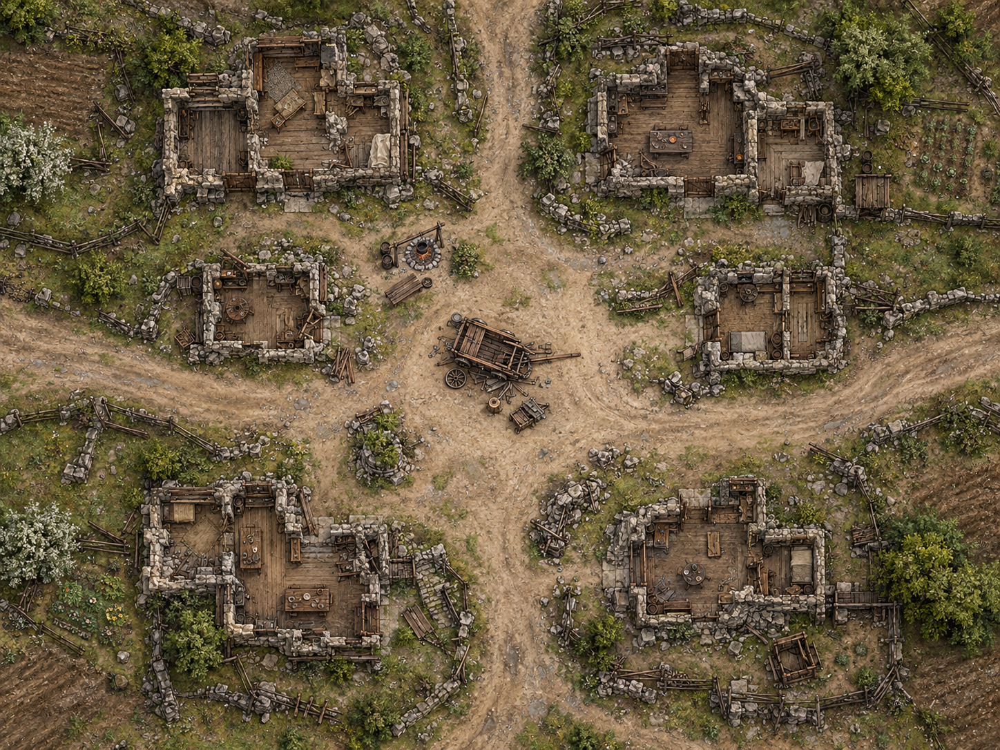

# VTT — Import & Penempatan

Paket inti berisi empat map tanpa grid permanen dan enam belas desain token PNG. Belum dipasang ke aplikasi VTT. Bentuk bangunan, jarak, wajah, warna rambut, dan pakaian yang belum dijelaskan modul adalah interpretasi visual untuk sesi, bukan tambahan canon.

Lihat [[VTT - Maps and NPC Tokens]] untuk roster lengkap dan tambahan opsional. Ukuran asli serta hasil pemeriksaan file ada di `Assets/Production/asset-manifest.json`.

## Impor

1. Tambahkan gambar dari `Assets/Maps` sebagai background atau scene. Gunakan seluruh gambar tanpa crop dan pertahankan aspect ratio.
2. Untuk M02, gunakan bidang **40 × 30 petak**, 5 ft per petak. Gambar asli **1448 × 1086 px**, sehingga ukuran grid asli **36,2 px**. Jika VTT memakai petak 100 px, atur ukuran gambar pada canvas menjadi 4000 × 3000; ini pembesaran tampilan, bukan gambar asli beresolusi 4K.
3. Untuk M03, gunakan **36 × 24 petak**, 5 ft per petak. M04 dapat memakai **36 × 28 petak** atau grid dimatikan. M01 adalah overview untuk navigasi; matikan pengukuran taktis.
4. Tambahkan PNG dari `Assets/Tokens` sebagai token Medium berukuran satu petak. Gambar token asli berukuran **1254 × 1254 px**, dengan transparansi di luar bingkai lingkaran. Tidak perlu memotongnya lagi.
5. Duplikasi T01 menjadi empat Silverbinders, T02 menjadi lima anggota Covenant Warband, dan T03 menjadi empat Dawn Knights. Nomori salinan pada VTT agar HP/kondisi tiap anggota terpisah.

Map adalah ilustrasi dengan kalibrasi permainan yang diusulkan, bukan gambar CAD atau hasil playtest. Jarak pada gambar dan panjang jembatan tidak dijamin persis mengikuti brief awal. Tetapkan ukuran jalur, cover, dan tepi jurang secara konsisten sebelum initiative; batu lantai dekoratif bukan grid gerak.

## M01 — Elysgard

Gunakan sebagai hub eksplorasi dan epilog. Pilih gedung yang sesuai untuk medical hall, memory hall, library, temple, dan lodgings, lalu pertahankan penetapannya. Ruangan yang tidak diberi token tetap dapat dikunjungi melalui narasi. Lima pemimpin Silverlight belum termasuk paket token inti; mereka dapat dimainkan lewat nama/percakapan sampai portrait tambahannya dibuat.

Kaede memakai N04. **Jangan tampilkan tubuh Vaeil saat audiensi Part I**; pertemuan tersebut berlangsung melalui suara. Temple dan Archive bukan satu tempat dan tidak disambungkan oleh pintu rahasia pada map ini.

## M02 — Hollow Refuge

Map pemain: [[../Assets/Maps/M02-hollow-refuge-player-v1.png|M02 Hollow Refuge]].

Utara berada di atas gambar. Titik berikut adalah **usulan**, bukan penempatan canon yang wajib; sesuaikan titik pada lantai yang bisa dilewati. Koordinat memakai persentase lebar dan tinggi gambar, dihitung dari kiri atas.

| Token | Titik awal (x%, y%) | Keterangan |
|---|---|---|
| N01 perempuan | 48%, 43% | Di samping roda gerobak pusat. Label pemain “Perempuan Bermata Perak”. |
| N04 Kaede | 42%, 52% | Dekat kedatangan party. |
| Party | Sekitar 42%, 57% | Susun terpisah di jalan, bukan bertumpuk di gerobak. |
| C01 pengemudi | 53%, 53% | Dekat bagian gerobak yang rusak. |
| C02 anak Human | 45%, 46% | Menonton perbaikan. |
| C03 anak Tiefling | 43%, 43% | Token tersendiri, dekat anak lainnya. |
| C04 juru masak | 39%, 34% | Dekat pot memasak, barat laut gerobak. |
| C05 penolong | 60%, 51% | Di jalan menuju rumah perlindungan timur. |
| C06 rekan terluka | 62%, 53% | Bersebelahan dengan penolong. |
| N05 Kaelion + T01 ×4 | Masuk dari barat, sekitar 4%, 46% | Simpan tersembunyi sampai kedatangan pasukan. |
| N06 Mordren + T02 ×5 | Masuk dari timur, sekitar 95%, 46% | Simpan tersembunyi sampai kedatangan pasukan. |

Rumah terbuka di kiri dan kanan pusat dapat dijadikan shelter. Jalan utara adalah jalur evakuasi; tembus ke sana tidak otomatis membuat perempuan tertangkap pasukan timur. Tandai ketika warga sudah mencapai shelter atau keluar dari konflik. Jangan mengulang bahaya pada warga yang sudah aman tanpa ancaman baru yang dinyatakan.

**Awal adegan:** tampilkan party, perempuan, Kaede jika hadir, dan enam warga. Pasukan muncul saat alarm dan kedatangan benar-benar dimainkan. Mereka awalnya saling berhadapan; bukan sembilan musuh yang otomatis menyerbu PC.

**Setelah konflik:** catat enam warga secara individual, status perempuan, serta keadaan kedua komandan. Keberhasilan menyembunyikan perempuan tetap berlaku; jangan memaksa dialog pengenalan Catalyst jika ia berhasil keluar tanpa terlihat.

## M03 — Sunwatch & Bridge

Outpost berada di pendekatan barat. Party dan pendamping datang dari barat; Kiyomasa serta empat Dawn Knights menghalangi jalan ke timur. Tempatkan mereka pada ujung/landing yang menyisakan ruang percakapan, bukan langsung mengepung perempuan.

Ra (N03) muncul setelah encounter selesai sesuai Part III–IV. Kiyomasa memakai N07, pasukannya T03 ×4. Tidak ada token Sun Rays khusus pada paket inti: kehadiran mereka dapat digambarkan melalui narasi. Jika party sudah melewati jembatan, kedatangan dimainkan pada jalan yang mereka capai.

## M04 — Infinite Archive

Vaeil (N02) berada di meja dekat pohon. Letakkan party pada jalur masuk dan kursi yang tersedia; perempuan tetap memakai N01, Ra memakai N03. Kaede hanya muncul jika memang ikut masuk. Kiyomasa dan pasukan tinggal di luar.

Buku besar pada stand di kanan meja dapat mewakili Book Beyond History. Pohon dan sungai cahaya adalah fitur tempat, bukan musuh. Gunakan narasi atau efek VTT untuk cahaya fragmen; jangan membuat token tubuh perempuan kedua untuk menampilkan kilas balik. Vaelithra yang hadir tetap berada di sisi party sementara satu fragmen menuju beberapa bulan sebelumnya.

## Indeks token

| ID | Nama untuk DM | Salinan |
|---|---|---|
| N01 | Perempuan Bermata Perak / Vaelithra | 1 |
| N02 | Vaeil | 1 |
| N03 | Ra | 1 |
| N04 | Kaede Veyr | 1 |
| N05 | Ser Kaelion Veyr | 1 |
| N06 | Mordren Ashveil | 1 |
| N07 | Grand Captain Kiyomasa | 1 |
| T01 | Silverbinder | 4 pada Hollow Refuge |
| T02 | Covenant Warband | 5 pada Hollow Refuge |
| T03 | Dawn Knight | 4 pada Bridge |
| C01–C06 | Enam warga yang berbeda | Masing-masing 1 |

Status wounded, restrained, unconscious, rescued, atau departed dilacak pada token VTT; tidak memerlukan gambar baru. Token yang mati atau pergi tidak dimunculkan kembali saat pindah scene.
